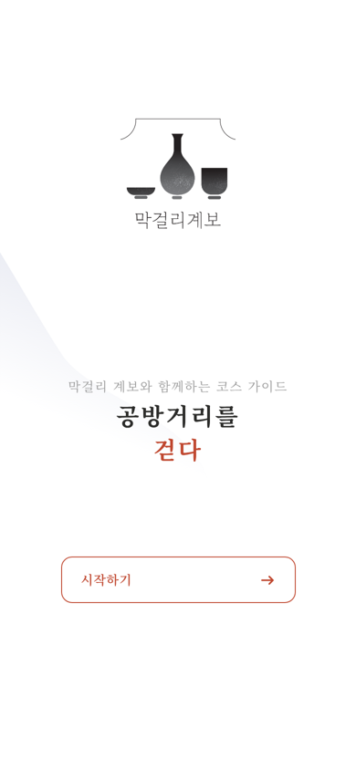
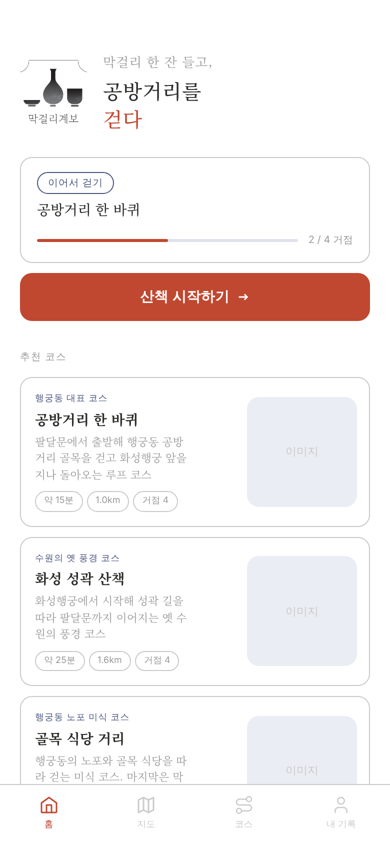

# 막걸리 계보 × 行-on — 2026 로커톤

**막걸리 한 잔을 거리로 꺼내, 비어 있던 공방거리를 다시 걷게 만드는 웹 서비스 두 개.**
수원 행궁동의 전통주점 '막걸리 계보'와 주변 공방거리를 함께 살리기 위해 2026 로커톤에서 팀 行-on이 만든 프로젝트입니다.

| 산책 웹맵 — 시작 화면 | 산책 웹맵 — 코스 선택 | 막걸리 계보 웹 |
|---|---|---|
|  |  |  |

## 문제

사장님과의 대면 인터뷰로 문제를 정리했습니다.

- 오픈 3개월 차 가게로, 평일과 이른 저녁 손님이 특히 적었습니다.
- 가게가 골목 안쪽에 있어 지나가다 들어오는 손님이 드뭅니다.
- 공방거리는 일직선 골목이라 저녁이 되면 사람이 끊깁니다.
- 막걸리마다 산지, 양조장, 맛 이야기가 있지만 손님에게 전할 채널이 없었습니다.

## 해결: 가게 밖으로(OUT), 다시 가게로(BACK)

리브랜딩과 테이크아웃 패키징이 손님을 거리로 내보내고(OUT), 두 웹 서비스가 공방거리를 거쳐 다시 가게로 돌아오게(BACK) 만드는 구조입니다. 이 저장소에는 그중 디지털 부분인 웹 서비스 두 개가 있습니다.

| | `walk-app/` 막걸리 산책 웹맵 | `gyebo-web/` 막걸리 계보 이야기 |
|---|---|---|
| 하는 일 | 팔달문에서 공방거리를 거쳐 가게로 돌아오는 산책 코스 안내 | 막걸리 10종의 산지·양조장·맛 이야기와 취향 추천 |
| 주요 기능 | 코스 3개(1.0~1.6km), 지도 위 경로와 거점 표시, GPS로 실제 걸은 거리를 계산해 막걸리 발효 4단계로 보여주는 진행도 게이지 | 5문항 취향 설문으로 10종 중 한 잔 추천, 단맛·산미·바디감을 지도 위에 펼친 '맛의 지형도', **한국어·영어·중국어 3개 언어 지원** |
| 기술 | React 19, Vite, MapLibre GL(MapTiler), Kakao Maps SDK, Geolocation API(하버사인 거리 계산) | React 19, Vite, three.js(WebGL), GSAP, Lenis |
| 코드 규모 | JS/JSX 약 2,100줄 | JS/JSX 약 2,300줄 |

코드 규모는 빈 줄과 주석을 뺀 JS/JSX 줄 수입니다.

## 팀과 역할

- 팀 行-on: 8명 (소프트웨어융합학과, 컴퓨터공학과, 디자인 계열 학과, 중국어학과)
- 웹 서비스 두 개는 개발자 2명이 함께 만들었습니다.
- **최서현 (중국어학과):** 프로젝트 기획, 두 웹 서비스 공동 개발, 계보 웹 중국어 번역

## AI 활용

서비스 설계와 화면 흐름은 팀이 직접 정했고, 코드 작성에는 AI 코딩 도구 Claude Code의 도움을 받았습니다. `walk-app/CLAUDE.md`는 그때 사용한 작업 안내 파일입니다.

## 실행 방법

Node.js 20 이상이 필요합니다.

```bash
# 막걸리 계보 이야기
cd gyebo-web
npm install
npm run dev

# 막걸리 산책 웹맵 (지도 API 키 필요)
cd walk-app
cp .env.example .env   # .env에 본인 키 입력
npm install
npm run dev
```

산책 웹맵은 지도 API 키 두 개를 `.env`에서 읽습니다. 키는 저장소에 올리지 않습니다.

| 변수 | 발급처 |
|---|---|
| `VITE_KAKAO_MAP_KEY` | [Kakao Developers](https://developers.kakao.com) JavaScript 키 |
| `VITE_MAPTILER_KEY` | [MapTiler Cloud](https://cloud.maptiler.com) API 키 |

Vercel에 배포할 때는 같은 이름으로 프로젝트 환경변수(Environment Variables)에 넣으면 됩니다.

## 폴더 구조

```
walk-app/    막걸리 산책 웹맵 (React + Vite)
gyebo-web/   막걸리 계보 이야기 웹 (React + Vite)
docs/        README용 화면 캡처
```
